# Architecture and delivery plan

## Scope

A generic, API-first SaaS foundation. The MVP includes OIDC authentication,
tenant onboarding, tenant membership and roles, a Projects CRUD example,
transactional audit events, database migrations, runnable local infrastructure,
and tests of the actual PostgreSQL security boundary.

Billing, email invitations, a frontend, ownership transfer, tenant deletion,
custom identity management, and distributed jobs are outside this release.

## Decisions

| Area | Decision | Reason |
| --- | --- | --- |
| Runtime | Java 25, Spring Boot 4.1.2, Maven Wrapper | LTS Java baseline; current stable Boot verified at implementation time |
| Structure | Modular monolith, packages by feature | One deployable, explicit transactions, straightforward extension |
| Persistence | PostgreSQL 17, JDBC, Flyway | Explicit SQL makes tenant predicates and lock behavior reviewable |
| Tenancy | Shared schema, explicit tenant predicates plus forced PostgreSQL RLS on projects and audit | Fail closed when tenant context is missing; affordable MVP isolation |
| Control plane | Global tenant/membership tables, authorized in services | Membership discovery must span tenants; this boundary receives dedicated tests |
| Identity | OIDC resource server; Keycloak for local development | Passwords, recovery, MFA, and signing keys belong to an identity provider |
| Authorization | OWNER / ADMIN / MEMBER stored per tenant | Never trust a tenant header or JWT role as proof of membership |
| Redis | Omitted | No session store, shared cache, or distributed limiter is needed by this MVP |
| License | MIT | Simple permissive reuse; dependencies retain their own licenses |

## Request path

```mermaid
flowchart LR
  Client -->|Bearer token| Security[Spring Security: signature, issuer, audience, expiry]
  Security --> API[Validated REST controller]
  API --> Service[Transactional feature service]
  Service --> Membership[Check tenant membership and role]
  Membership --> Context[SET LOCAL tenant context]
  Context --> SQL[Explicit tenant predicates]
  SQL --> RLS[PostgreSQL forced row security]
```



The path UUID selects a tenant; it does not grant access. Each tenant-scoped
service starts a transaction, checks and locks the membership row, and sets
the tenant using transaction-local `set_config`. There is no thread-local
tenant state. Commit/rollback clears the database context before pooled
connections are reused. Background work must use the same boundary.

The runtime database role has DML grants only. A separate migration role owns
the schema. Runtime startup rejects a superuser, a role that bypasses RLS, or
ownership of protected tables. RLS is defense against missing SQL predicates,
not a defense against a compromised application or arbitrary SQL execution.

Only OWNER can add/change/remove ADMIN and MEMBER memberships. The owner is
immutable in the MVP, preventing last-owner races and accidental lockout.
ADMIN and OWNER can mutate projects; MEMBER can read them. All members can
list memberships; only OWNER and ADMIN can read audit history.

## Repository layout

```text
src/main/java/io/github/chafian/saas/
  security/       JWT validation and HTTP security
  tenancy/        Tenant onboarding, membership authorization, transaction context
  project/        Example CRUD and optimistic concurrency
  audit/          Append-only application audit writes
  common/         Safe API errors and database privilege checks
src/main/resources/db/migration/  Versioned PostgreSQL schema
src/test/                         PostgreSQL integration and JWT security tests
infra/                           Local identity realm and database bootstrap
scripts/                         Local environment and end-to-end smoke example
docs/                            Architecture, API, operations, review evidence
.github/                         CI, dependency maintenance, contribution templates
```

## Milestones and acceptance gates

1. **Foundation:** pinned build, migrations, least-privilege roles, local Compose.
   Gate: fresh database migrates and application becomes healthy.
2. **Identity and tenancy:** signed JWT validation, tenant creation/listing,
   membership management. Gate: untrusted tokens and cross-tenant access fail.
3. **Example domain:** project CRUD, bounded pagination, optimistic updates,
   transactional audit. Gate: permission matrix, stale writes, rollback and RLS tests pass.
4. **Release preparation:** Docker smoke run, CI, API examples, operational
   guidance, license and review. Gate: `./mvnw verify` and smoke example pass;
   no secrets or private code; no remote/push until owner approval.

## Testing strategy

Use JUnit and Spring integration tests against a real PostgreSQL Testcontainer.
Apply production migrations with the migration role, then exercise the API
using the restricted runtime role. Sign real RSA JWTs and serve test JWKS over
HTTP so authentication tests cover decoding, not a mocked security principal.
Test both API authorization and direct SQL RLS, including pooled-connection
reuse, tenant switching, unauthorized writes, optimistic conflict, membership
revocation, owner protection, and atomic audit changes. Docker is mandatory
for the full suite; missing Docker is a failure, never a silent skip.

Compose smoke checks add the real Keycloak issuer and packaged application.
CI runs the same verification and smoke path. No latency or scale guarantees
are claimed without load tests.

## Upstream references

- [Spring Boot system requirements](https://docs.spring.io/spring-boot/system-requirements.html)
- [Spring Security JWT resource server](https://docs.spring.io/spring-security/reference/servlet/oauth2/resource-server/jwt.html)
- [PostgreSQL row security](https://www.postgresql.org/docs/17/ddl-rowsecurity.html)
- [Keycloak documentation](https://www.keycloak.org/documentation)
